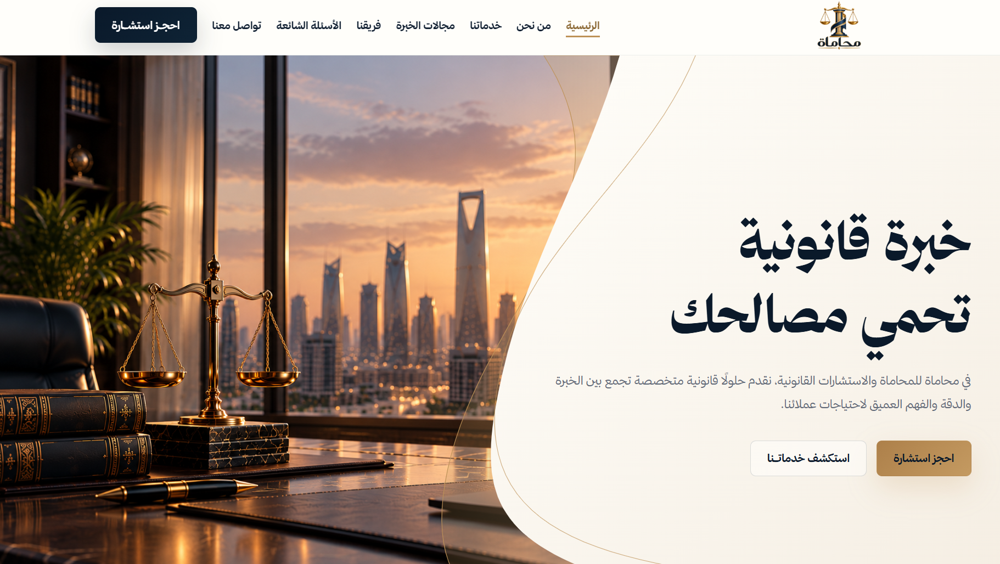
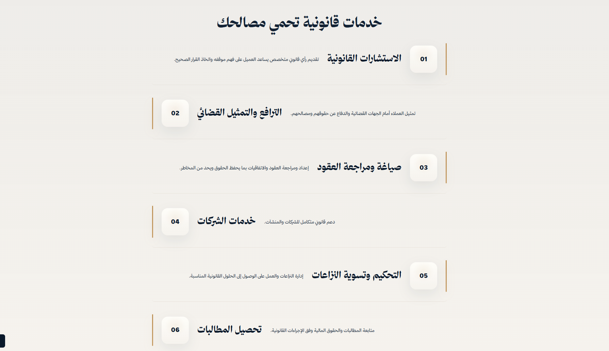
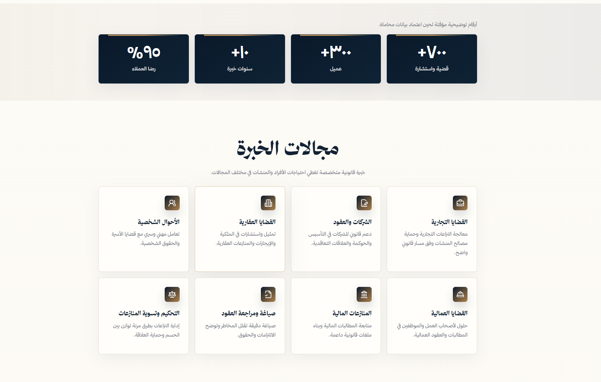
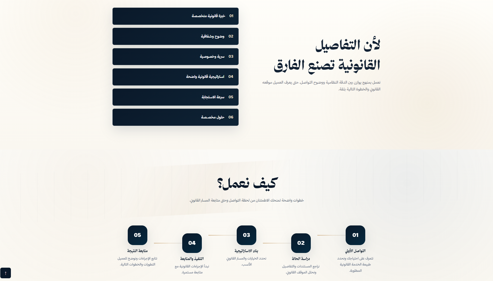
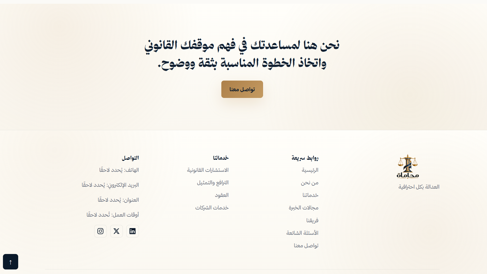
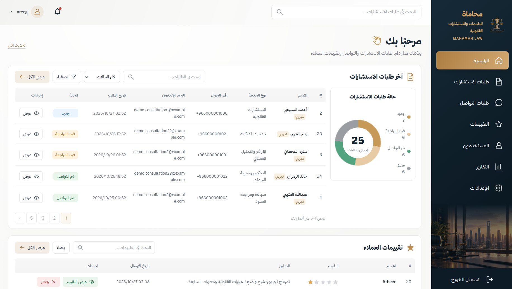
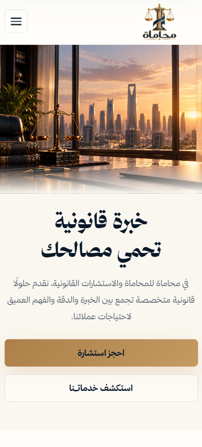
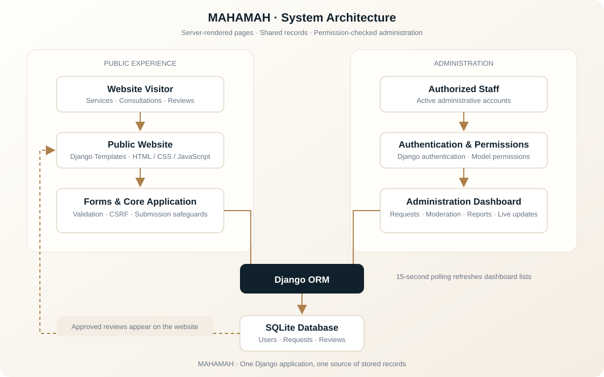
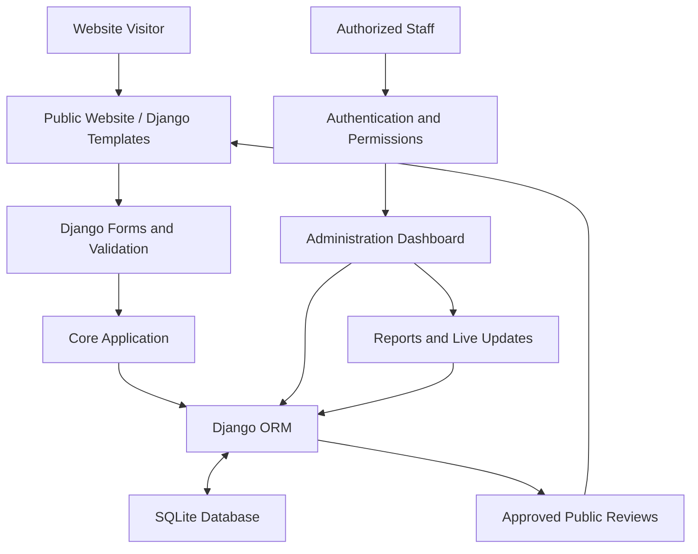

<p align="center">
  
</p>

# MAHAMAH | محاماة

### Legal expertise, thoughtfully delivered.

**MAHAMAH** is an Arabic-language legal services web application built with **Django**. It brings together a responsive public website for exploring legal services and submitting inquiries, and a dedicated administration dashboard for managing consultations, contact requests, customer reviews, and operational reporting.

The experience is designed around right-to-left (RTL) navigation, a navy-and-gold visual identity, accessible interactions, and a structured workflow for handling incoming requests.


> **Project note:** Some names, figures, and professional descriptions in the demonstration interface are illustrative placeholders, not verified client results or professional credentials.

## Project Overview

MAHAMAH provides two connected experiences:

- **Public website:** Introduces the platform, its legal services and practice areas, and offers consultation, contact, and review submission forms.
- **Administration dashboard:** Gives authorized staff a central place to review submissions, manage request statuses, moderate reviews, view reports, and manage operational preferences.

Both experiences use the same Django application and database, so submitted information can move from the public interface into administrative workflows without manual duplication.

## Key Features

### Public Website

- Responsive, Arabic-first RTL interface with mobile navigation.
- Legal services and practice areas presented through reusable sections and SVG icons.
- About, team, methodology, and frequently asked questions sections.
- Consultation and general contact submissions with server-side validation and user feedback.
- Customer ratings from **1 to 5 stars**, requiring an explicit selection.
- Public display of approved reviews only, with moderation before publication.
- Smooth reveal animations, animated counters, back-to-top navigation, and reduced-motion support.
- Locally hosted **Thmanyah Display** and **Thmanyah Sans** fonts.

### Administration Dashboard

- Centralized management of consultation and contact requests.
- Request search, status filtering, pagination, and detailed records.
- Status and request-type updates, plus internal administrative notes.
- Review approval and rejection workflows with confirmation where required.
- Request-status visualization and date-filtered reporting.
- Automatic dashboard refresh every **15 seconds** when enabled and the tab is active.
- Session-based preferences for pagination and automatic refresh.
- Staff authentication, model-level permissions, and separation of viewing and editing privileges.
- Administrative change logging through Django's admin log.

## Screenshots

### Homepage — Desktop



<details>
<summary><strong>Legal Services</strong></summary>



</details>

<details>
<summary><strong>Practice Areas</strong></summary>



</details>

<details>
<summary><strong>Why MAHAMAH & Our Process</strong></summary>



</details>

<details>
<summary><strong>Contact & Footer</strong></summary>



</details>

<details>
<summary><strong>Administration Dashboard</strong></summary>



</details>

### Mobile Experience



## Technology Stack

| Technology | Role in the project |
| --- | --- |
| **Python** | Server-side application logic, management commands, and tests. |
| **Django 5.2** | URL routing, forms, models, ORM, authentication, permissions, sessions, and administration. |
| **SQLite** | Relational storage for users, requests, reviews, and submission safeguards. |
| **Django Templates** | Server-rendered pages and reusable interface components. |
| **HTML5 & CSS3** | Responsive RTL layouts, visual identity, and interface styling. |
| **Vanilla JavaScript** | Navigation, FAQs, ratings, animations, and background dashboard updates using `fetch()`. |
| **SVG** | Scalable interface and practice-area icons, including Lucide and Bootstrap Icons assets. |
| **Thmanyah Fonts** | Locally served display and interface typography. |
| **Django TestCase** | Automated coverage of core workflows, permissions, and dashboard behavior. |

The runtime dependencies are defined in [`requirements.txt`](requirements.txt). The interface does not require a separate frontend build step.

## System Architecture

MAHAMAH uses Django's server-rendered architecture. Public forms validate submissions before saving them through the Django ORM. The administration dashboard accesses the same records through authenticated, permission-checked views.



<details>
<summary>View the Mermaid diagram source</summary>



</details>

### Application Responsibilities

| Application | Responsibility |
| --- | --- |
| `apps/accounts` | Custom user model and Django authentication integration. |
| `apps/core` | Public pages, submissions, reviews, validation, and supporting management commands. |
| `apps/dashboard` | Administrative pages, permissions, filtering, reporting, and live updates. |

## Project Structure

```text
محاماه/
├── apps/
│   ├── accounts/             # Users and authentication
│   ├── core/                 # Public pages, forms, models, and workflows
│   └── dashboard/            # Administration interface and reporting
├── config/                   # Django settings, routing, WSGI, and ASGI
├── templates/
│   ├── base.html
│   ├── pages/
│   ├── includes/
│   └── dashboard/
├── static/
│   ├── css/
│   ├── js/
│   ├── fonts/
│   ├── images/
│   └── licenses/
├── screenshots/              # Project screenshots used in this README
├── tests/                    # Automated application and dashboard tests
├── dev.py                    # Local development helper
├── manage.py
├── requirements.txt
├── .env.example
└── README.md
```

The `static/` directory contains source assets. Django's `collectstatic` command prepares the files for production delivery.

## Getting Started

### Prerequisites

- Python **3.10 or later** (the project was verified with Python 3.13.14).
- `pip` and Python's `venv` module.
- A modern web browser.

Run the following commands from the application directory containing `manage.py`.

### 1. Create a Virtual Environment

**Windows (PowerShell)**

```powershell
python -m venv .venv
.\.venv\Scripts\Activate.ps1
python -m pip install -r requirements.txt
```

**Linux / macOS**

```bash
python3 -m venv .venv
source .venv/bin/activate
python -m pip install -r requirements.txt
```

### 2. Configure the Environment

For local development, `dev.py` generates and maintains a local secret when needed and sets development defaults without exposing the secret in the repository.

Alternatively, configure the required environment variables before running `manage.py` directly:

| Variable | Purpose |
| --- | --- |
| `DJANGO_SECRET_KEY` | Required secret used by Django. |
| `DJANGO_DEBUG` | Set to `True` locally and `False` in production. |
| `DJANGO_ALLOWED_HOSTS` | Comma-separated list of permitted hostnames. |

The included [`.env.example`](.env.example) is a reference for configuration values. Environment files are **not automatically loaded** by the Django settings in this project.

**Never commit secret keys, credentials, or production environment files.**

### 3. Apply Database Migrations

```bash
python dev.py migrate
```

### 4. Create an Administrator Account

```bash
python dev.py createsuperuser
```

No default administrative credentials are included.

### 5. Start the Development Server

```bash
python dev.py runserver 127.0.0.1:8020
```

| Interface | Local URL |
| --- | --- |
| Public website | `http://127.0.0.1:8020/` |
| Administration dashboard | `http://127.0.0.1:8020/dashboard/` |
| Dashboard login | `http://127.0.0.1:8020/dashboard/login/` |
| Django Admin | `http://127.0.0.1:8020/admin/` |

## Database Design

The project uses SQLite and Django's ORM. Its primary models include:

| Model | Purpose |
| --- | --- |
| `accounts.User` | Administrative user accounts and authentication. |
| `core.ContactRequest` | Consultation and contact submissions, including status and internal notes. |
| `core.Review` | Customer ratings, comments, and moderation status. |
| `core.SubmissionWindow` | Time-window tracking for submission rate limits. |
| `core.SubmissionReceipt` | Temporary safeguards against rapid duplicate submissions. |

Contact requests and reviews can be submitted by visitors without requiring an account. Database constraints validate relevant status values and keep ratings within the supported **1–5** range.

## Consultation & Contact Workflow

1. A visitor submits their name, phone number, service type, and message; email is optional.
2. Django validates the submission and applies anti-spam, rate-limit, and duplicate-submission checks.
3. A valid request is saved to the database and becomes available to authorized staff.
4. Staff review its details, update its status, change its request type when appropriate, and add internal notes.
5. Dashboard lists and visualizations reflect the latest saved records.

Requests use these statuses:

| Status | Meaning |
| --- | --- |
| `new` | Newly received. |
| `in_progress` | Under review. |
| `contacted` | The requester has been contacted. |
| `closed` | The request is closed. |

Consultations and general contact messages share the same request model and are distinguished by their request type.

## Customer Review Moderation

Customer feedback follows a controlled publication process:

1. A visitor selects a rating from **1 to 5 stars**, enters a name, and writes a review.
2. Django validates and saves the submission as **pending**.
3. Authorized staff inspect the review in the dashboard.
4. Staff can approve and publish it or reject it through the appropriate workflow.
5. The public website retrieves the latest **eight approved** reviews.

New reviews are **not published automatically**. Demonstration reviews are also excluded from production display, and illustrative placeholders are labeled when shown.

## Administration Dashboard

The dashboard provides dedicated views for:

- **Overview:** Recent consultation requests, reviews, and a request-status chart.
- **Consultations:** Searchable and filterable consultation records.
- **Contact Requests:** General inquiries and their progress.
- **Request Details:** Status, classification, and internal notes.
- **Reviews:** Moderation and publication controls.
- **Users:** Authorized administrative account listings.
- **Reports:** Request counts, trends, and review summaries with date filters.
- **Settings:** Session-based page-size and automatic-refresh preferences.

Dashboard access requires an authenticated, active staff account and the relevant Django model permissions. Viewing records and modifying them are treated as separate capabilities.

When enabled, background updates run every **15 seconds** while the browser tab is active. The interface pauses updates during certain user interactions to avoid disrupting ongoing work.

## Security & Data Integrity

The application includes the following safeguards:

- Django authentication and role-based model permissions.
- CSRF protection for state-changing forms.
- Server-side input validation through Django Forms.
- HTML escaping in rendered templates.
- Rate limiting for public submissions and login attempts.
- Honeypot field for basic automated-submission detection.
- Temporary duplicate-submission protection.
- Permission checks on dashboard pages and live-update endpoints.
- Private, non-cacheable responses for protected dashboard pages.
- Administrative logging of relevant changes.
- Production-oriented configuration for HTTPS, secure cookies, and clickjacking protection.

Deployment security also depends on correct hosting configuration, file permissions, backups, and appropriate handling of secrets and customer information.

## Testing

The project includes automated Django tests covering public forms, review moderation, dashboard behavior, authorization, data integrity, filtering, reporting, and submission safeguards.

Run the main checks with:

```bash
python dev.py check
python dev.py makemigrations --check --dry-run
python dev.py test tests
```

### Verified Development Results

As documented in the project on **October 27, 2026**, the development environment used **Python 3.13.14** and **Django 5.2.18** and reported:

| Check | Result |
| --- | --- |
| Django system checks | Passed |
| Model and migration consistency | No pending model changes |
| Automated Django tests | **34 passed** |
| Production configuration checks | Passed with the documented production test settings |
| Browser workflow checks | Public submission, dashboard updates, review moderation, and responsive layouts verified |

Browser checks are optional development tools; they are not required to run the application.

## Deployment

For production deployment:

1. Create a production Python environment and install `requirements.txt`.
2. Configure a strong, persistent `DJANGO_SECRET_KEY` outside the repository.
3. Set `DJANGO_DEBUG=False` and configure `DJANGO_ALLOWED_HOSTS` for the actual domain.
4. Configure the hosting platform's WSGI or ASGI entry point.
5. Apply migrations and collect static assets:

   ```bash
   python manage.py migrate
   python manage.py collectstatic --noinput
   python manage.py check --deploy
   ```

6. Serve collected static assets through the hosting platform.
7. Enable HTTPS and verify secure session and proxy settings.
8. Create authorized staff accounts, configure backups, and replace demonstration content with approved production information.

The repository documents deployment readiness; it does **not** imply that a public production deployment has already been completed.

## Future Enhancements

Potential improvements, not currently claimed as implemented:

- Email notifications for newly submitted requests.
- Appointment scheduling and detailed consultation follow-up history.
- Authorized report exports.
- Administrative password-recovery workflows.
- Editable content management for public website sections.
- Automated browser checks in continuous integration.
- Database scaling options for higher concurrent workloads.

## Developer

**Areeg Thallab Albogami**  
Software Engineering Student | Full-Stack Web Developer

## License

This repository does not currently include a project-wide `LICENSE` file. No open-source license is implied. Third-party assets retain their respective license terms; see the notices in [`static/licenses/`](static/licenses/).
